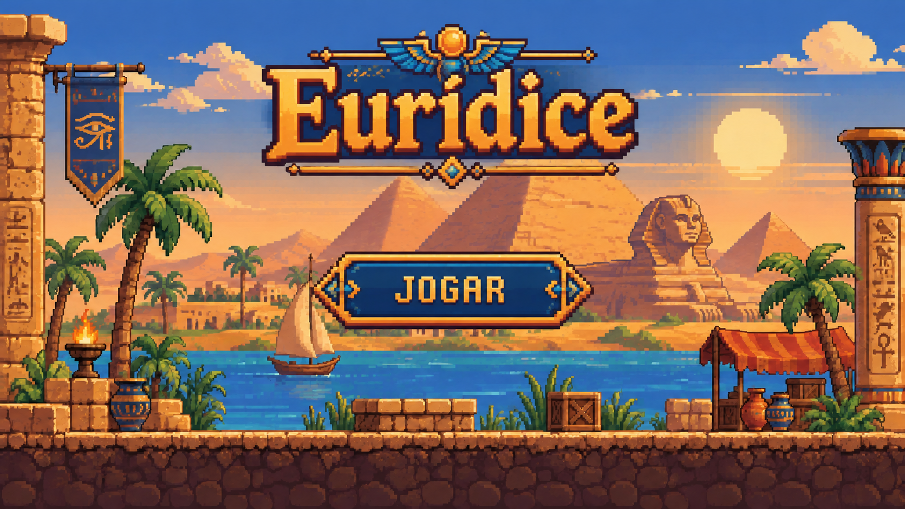
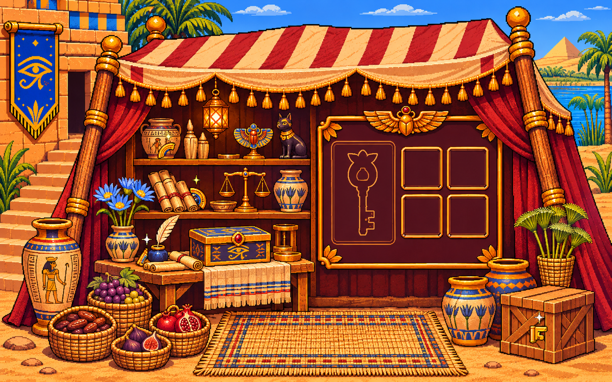
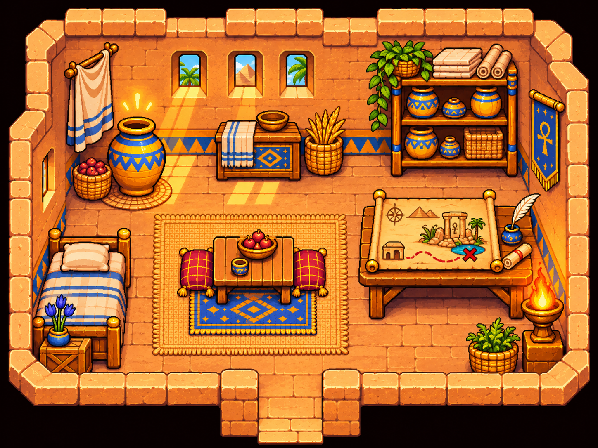
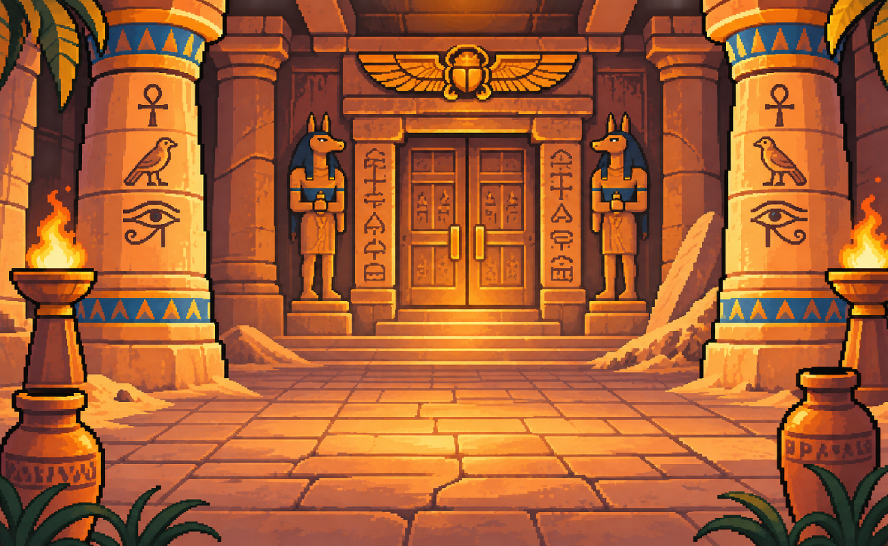

<div align="center">

# EURÍDICE

*Uma jornada através da história.*



<br>


[](#sobre-o-projeto)
[](#gameplay)
[](#explore-o-egito-antigo)
[](#mecânicas-do-jogo)
[](#tecnologias)
[](#instalação)
[](#equipe)

</div>


---
## Sobre o projeto

**Eurídice** é um jogo educativo de aventura e exploração histórica, desenvolvido por estudantes de Ciência da Computação do Centro Universitário Senac.

Ambientado no Egito Antigo, o jogo propõe uma forma diferente de aprender história, em que o jogador explora cenários, resolve enigmas, encontra pistas e descobre curiosidades sobre a civilização egípcia.

---

## Gameplay

Confira um pouco da jornada pelo Egito Antigo.

<!-- Adicionar o vídeo do jogo aqui -->


---

## Explore o Egito Antigo

Cada cenário guarda pistas, desafios e descobertas que fazem parte da jornada do explorador.

<table>
  <tr>
    <td align="center" width="50%">
      
      <br>
      <b>Mercado Egípcio</b>
      <p>Investigue os objetos e encontre pistas.</p>
    </td>
    <td align="center" width="50%">
      
      <br>
      <b>Casa Egípcia</b>
      <p>Explore o ambiente e descubra seus segredos.</p>
    </td>
  </tr>
  <tr>
    <td align="center" width="50%">
      
      <br>
      <b>Templo Egípcio</b>
      <p>Reúna as três chaves para destrancar o templo.</p>
    </td>
    <td align="center" width="50%">
  
  <br>
  <b>Rio Nilo</b>
  <p>Descubra sua importância para a civilização egípcia.</p>
</td>
    </td>
  </tr>
</table>

---

## Mecânicas do jogo

- Exploração de cenários em 2D.
- Interação com objetos e ambientes.
- Resolução de enigmas e missões.
- Coleta de pistas e chaves.
- Sistema de câmera e colisões.
- Curiosidades sobre o Egito Antigo.
- Trilha sonora e cenas audiovisuais.

## Controles

| Tecla | Ação |
| :---: | --- |
| <kbd>Espaço</kbd> | Iniciar a jornada |
| <kbd>E</kbd> | Interagir com o ambiente |
| <kbd>Enter</kbd> | Confirmar ações e entrar nos locais |
| <kbd>Esc</kbd> | Retornar ao mapa ou sair do jogo |
|<kbd>Mouse</kbd> | Interagir com a interface |
|<kbd>Setas</kbd> | Interagir com o personagem |


---

## Tecnologias

<div align="center">


</div>

| Tecnologia | Aplicação |
| --- | --- |
|<kbd>C</kbd> | Lógica e desenvolvimento do jogo |
| <kbd>Allegro 5</kbd> | Interface gráfica, imagens e áudio |
| <kbd>MSYS2</kbd> e <kbd>GCC</kbd> | Ambiente de compilação |
| <kbd>VS Code</kbd> | Desenvolvimento e depuração |
| <kbd>Git</kbd> e <kbd>GitHub</kbd> | Versionamento e colaboração |

## Instalação

Para executar o Eurídice localmente, siga as instruções abaixo.

### Pré-requisitos


---


### 1. Clone o repositório

```bash
git clone https://github.com/jogoeducativopi-beep/euridice.git
```

### 2. Acesse a pasta do projeto

```bash
cd euridice
```

### 3. Instale as dependências

Abra o terminal MSYS2 UCRT64 e execute:

```bash
pacman -S --needed mingw-w64-ucrt-x86_64-toolchain mingw-w64-ucrt-x86_64-allegro
```

### 4. Execute o jogo

- Abra a pasta do projeto no Visual Studio Code.
- Pressione `F5` para compilar e executar o jogo.
- Aproveite sua jornada pelo Egito Antigo!

---


## Equipe

<table align="center">
  <tr>
    <td align="center" width="33%">
      <a href="https://github.com/Tinasenac">
        
      </a>
      <br>
      <b>Anna Cristina</b>
      <br><br>
      <a href="https://github.com/Tinasenac">
        
      </a>
    </td>
    <td align="center" width="33%">
      <a href="https://github.com/kassandraroubadaphp">
        
      </a>
      <br>
      <b>Kassandra Nascimento</b>
      <br><br>
      <a href="https://github.com/kassandraroubadaphp">
        
      </a>
    </td>
    <td align="center" width="33%">
      <a href="https://github.com/LlyanaP">
        
      </a>
      <br>
      <b>Pollyana da Costa</b>
      <br><br>
      <a href="https://github.com/LlyanaP">
        
      </a>
    </td>
  </tr>
</table>

---

## Professor orientador

<div align="center">

<a href="https://github.com/tclaro">
  
</a>

**Thiago Claro**

[](https://github.com/tclaro)

</div>

---

<div align="center">

**EURÍDICE**

Ciência da Computação • Centro Universitário Senac • 2026

</div>
